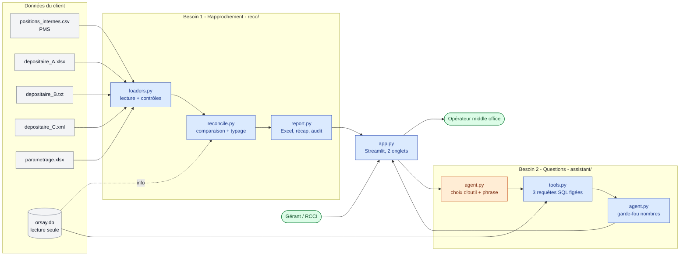
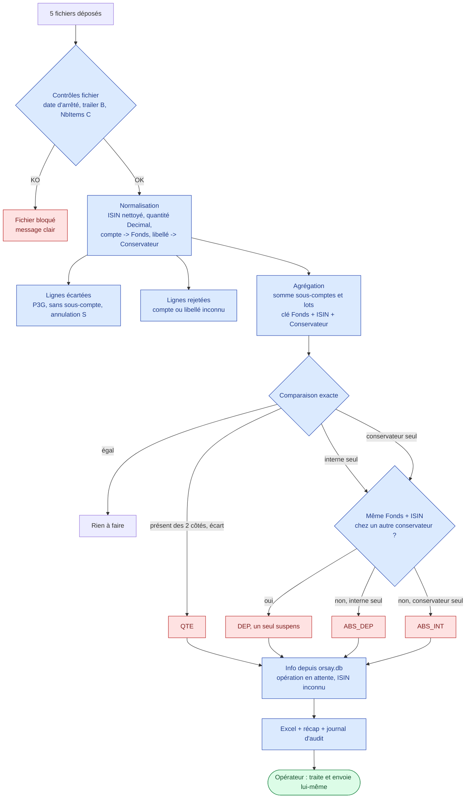
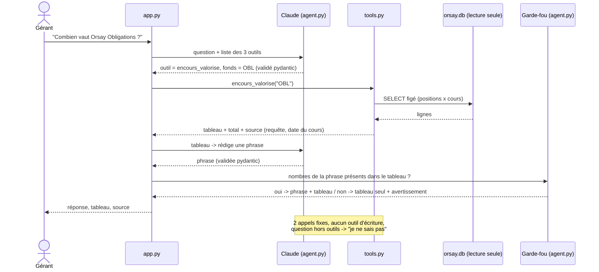

# Architecture

Légende des couleurs : **bleu = code déterministe**, **orange = LLM**, **vert = humain**, **gris = données**.

## Vue d'ensemble

## Besoin 1 : le rapprochement, étape par étape

## Besoin 2 : une question de gérant

## Rôle des fichiers

| Fichier | Type | Rôle |
|---|---|---|
| `config.toml` | paramètres | date d'arrêté, chemins, version des règles, modèle |
| `reco/loaders.py` | déterministe | lit les 5 fichiers, contrôles, lignes écartées et rejetées |
| `reco/reconcile.py` | déterministe | agrège, compare, classe QTE / ABS_DEP / ABS_INT / DEP |
| `reco/report.py` | déterministe | Excel, texte récapitulatif, journal d'audit JSON |
| `assistant/tools.py` | déterministe | 3 requêtes SQL figées en lecture seule, avec leur source |
| `assistant/agent.py` | LLM + garde-fou | choix d'outil, phrase de synthèse, contrôle des nombres |
| `app.py` | interface | Streamlit, onglets Rapprochement et Questions |
